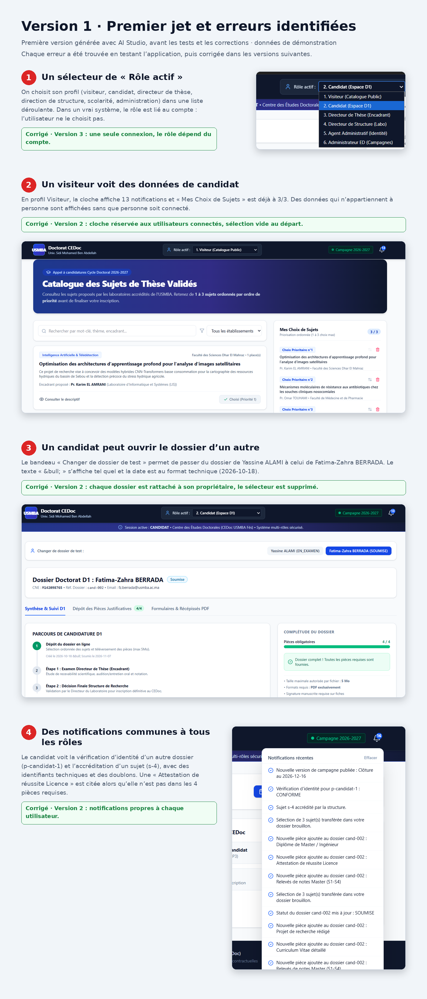

# Version 1 : premier jet (avec ses erreurs)

Première version générée avec AI Studio, avant les tests et les corrections.
Projet académique non officiel, données de démonstration.

## Erreurs identifiées

| Erreur | Corrigée en |
|---|---|
| Sélecteur de rôle à la place d'une connexion | Version 3 |
| Cloche et sélection visibles sans être connecté | Version 2 |
| Un candidat peut ouvrir le dossier d'un autre | Version 2 |
| Notifications communes à tous les rôles | Version 2 |

Version finale : dossier `Application-Portail-Doctorat-v3`.
