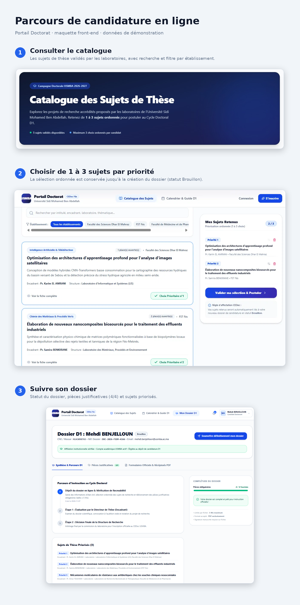
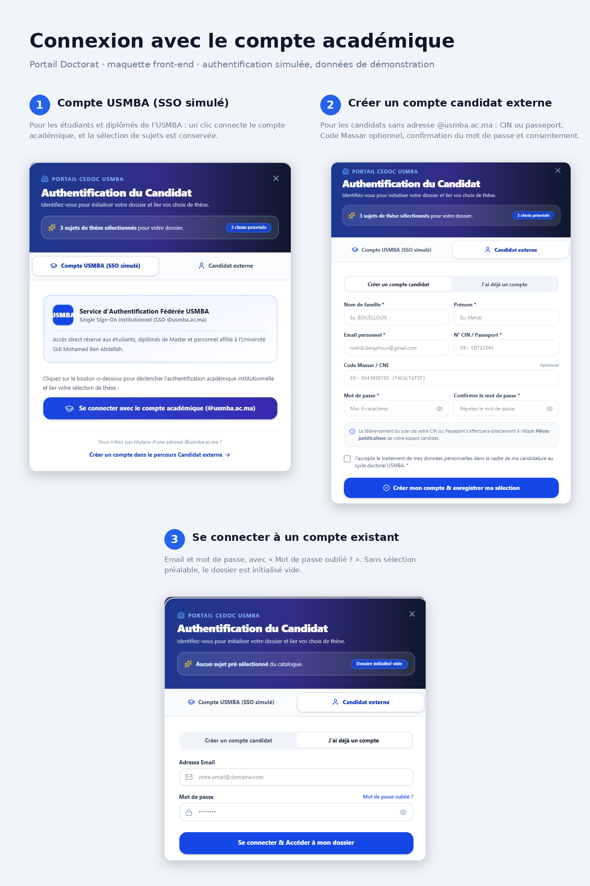
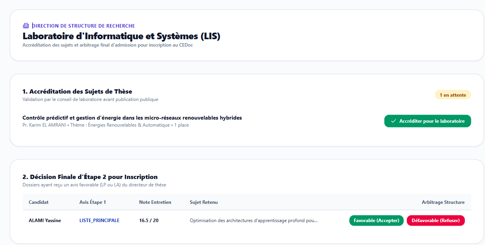
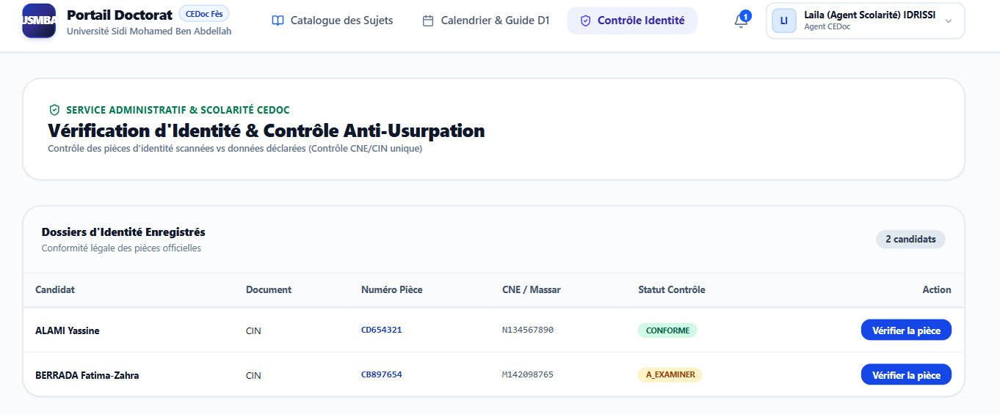
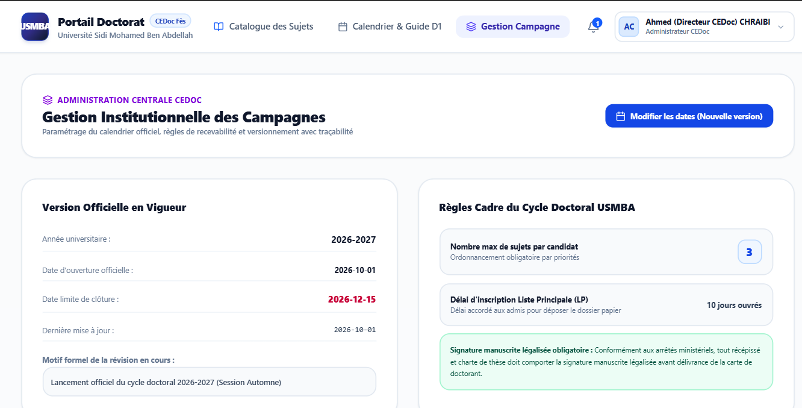

> Version intermédiaire, incomplète. Version finale : voir [v3](../v3).

# Application Portail Doctorat (maquette)

Projet académique non officiel : maquette front-end de gestion de la candidature au cycle doctoral. L'authentification est simulée.

Les diagrammes dont l'application découle sont dans le dossier [Diagrammes-Activite-Inscription-Reinscription-Cycle-Doctoral](../Diagrammes-Activite-Inscription-Reinscription-Cycle-Doctoral).

## 1. Parcours de candidature en ligne

## 2. Connexion avec le compte académique

## 3. Aperçu des interfaces de la plateforme

.png.png)

## Limites
Pas de backend : données de démonstration et authentification simulée.
