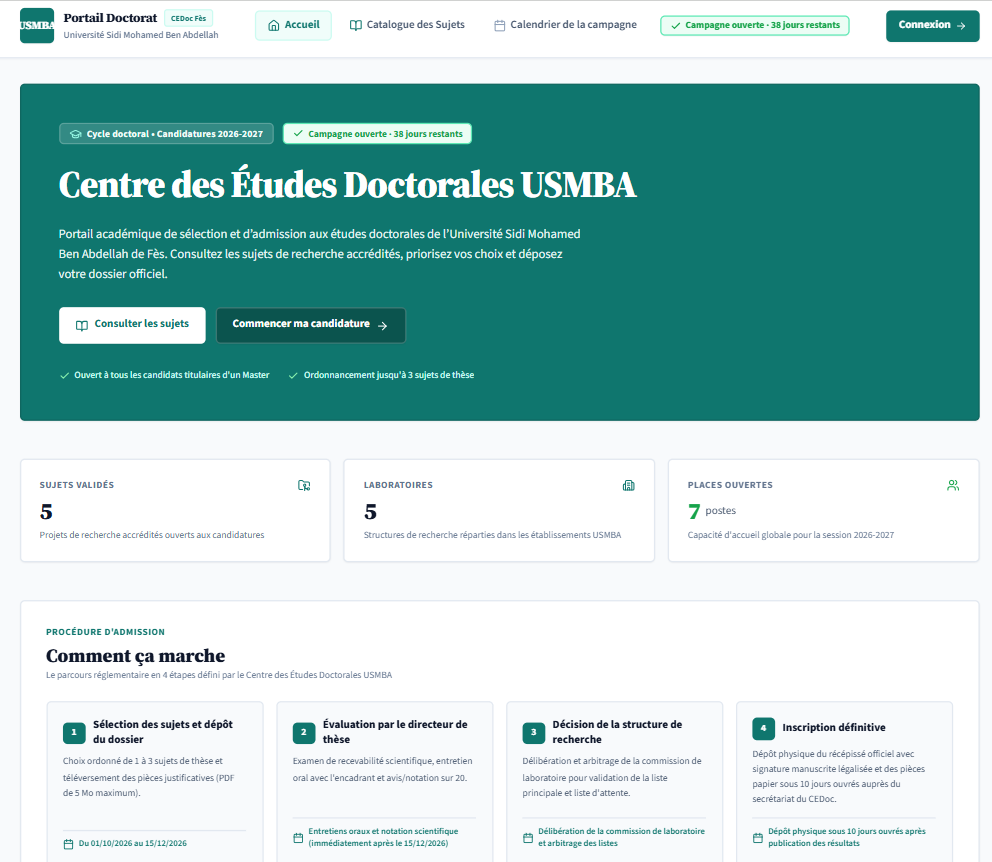
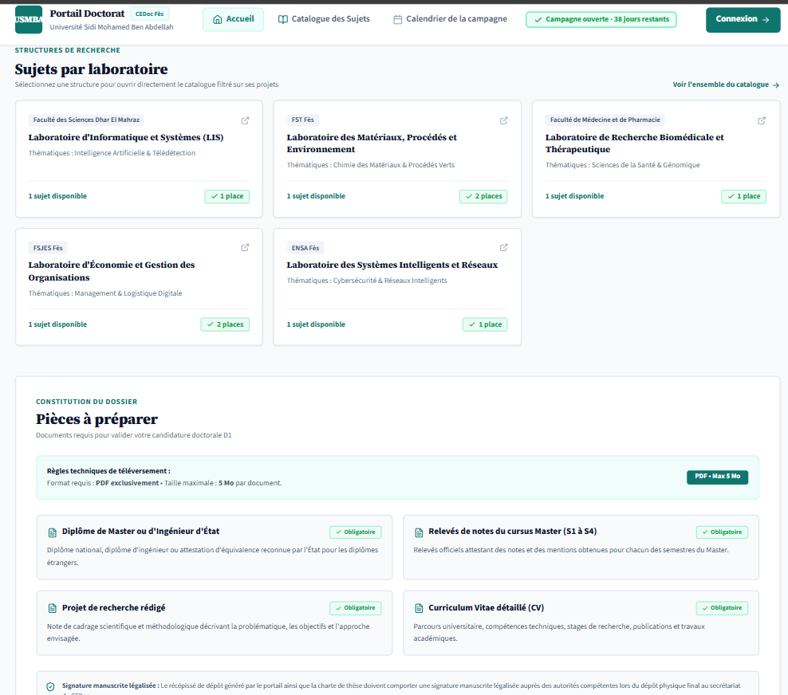
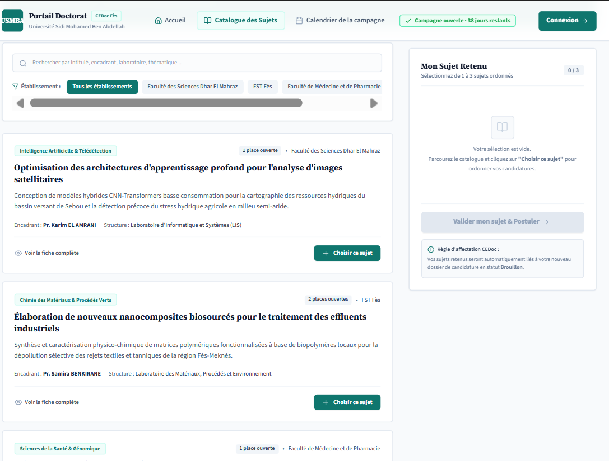
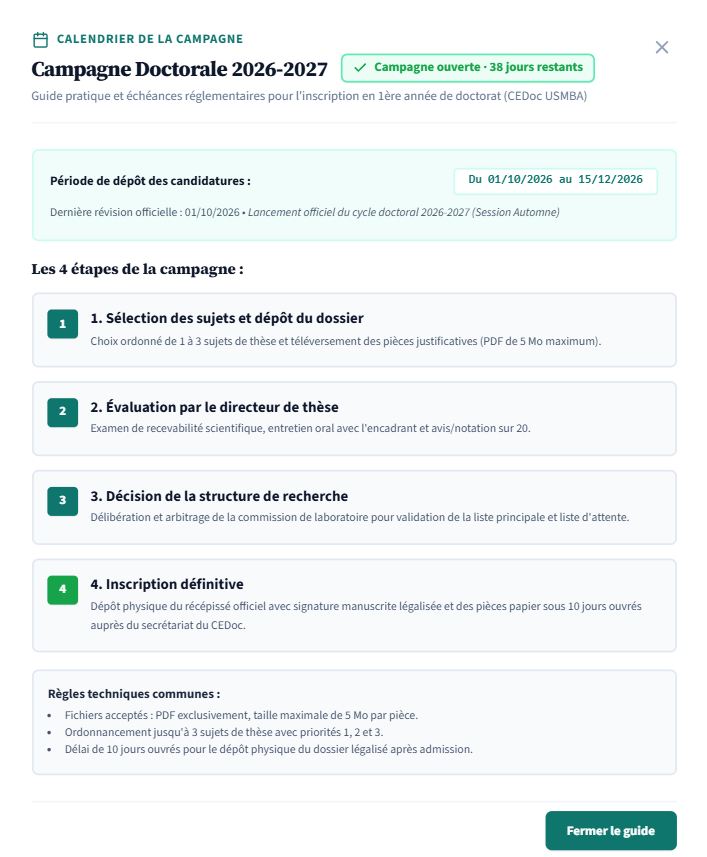
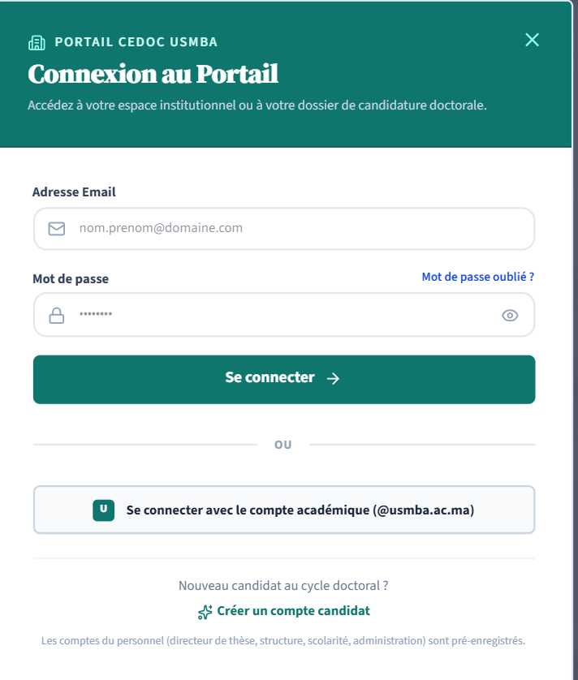
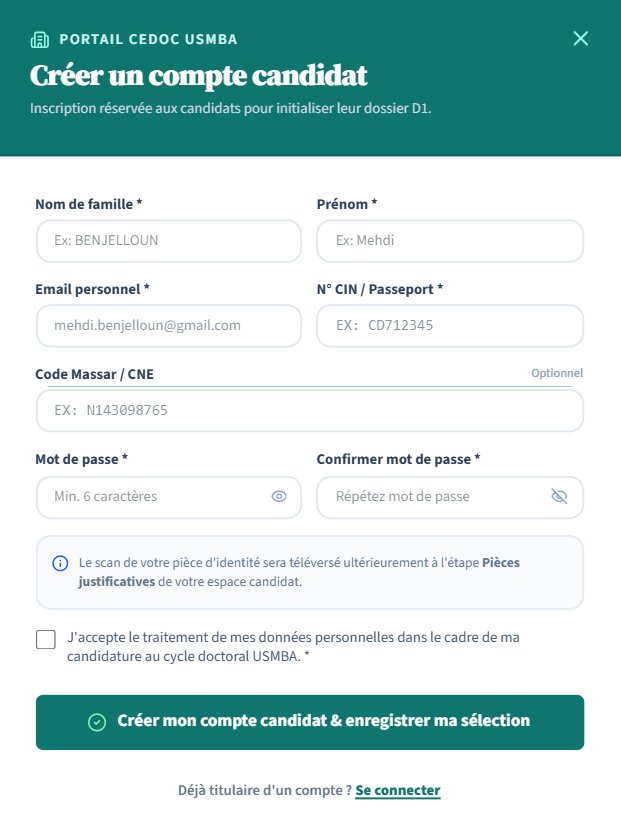
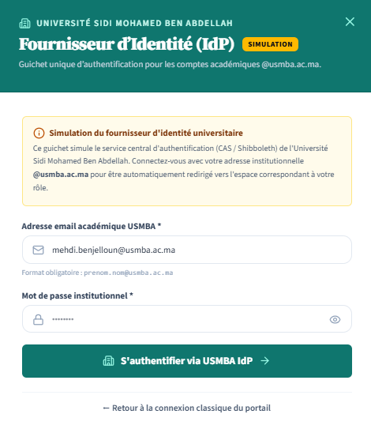

# Application Portail Doctorat, version 3 (finale)

## Aperçu des interfaces

## Accueil

## Accueil, laboratoires et pièces à préparer

## Catalogue des sujets

## Calendrier de la campagne

## Connexion

## Création de compte candidat

## SSO simulée

